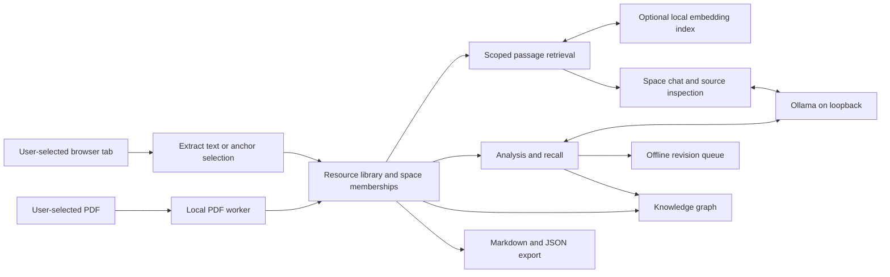
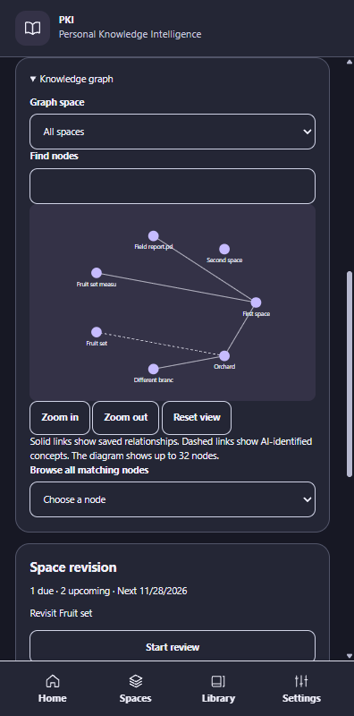

# Personal Knowledge Intelligence

PKI is an experimental Chrome and Brave side-panel extension for collecting reading material, connecting sources and practicing recall. Its starting question was practical: after saving several articles about the same subject, could a reader find the relevant passage again, explain it in their own words, and revisit it later? This project explores how far browser-native capture, local storage, retrieval and optional on-device AI can take that workflow.

## What you can do

| Destination | Implemented workflow |
| --- | --- |
| Home | Capture the current article, save a selected highlight with a color and note, restore highlights, request related saved material, resume reading or start daily revision. |
| Spaces | Set a learning goal, review progress, ask questions across saved sources, compare passages, and explore connections in a filtered graph or keyboard-accessible list. |
| Library | Search resources and passages, import a local text PDF, inspect extracted pages, edit notes and highlights, and study saved analyses offline. |
| Settings | Choose system, light or dark appearance, configure local generation, build or clear the optional embedding index, inspect storage estimates, export Markdown or JSON, merge backups and manage data. |

## Architecture

WXT builds a Manifest V3 extension with a React and TypeScript side panel. Readability extracts plain text from an isolated copy of a webpage. The highlight script maps a selection to document text and paints ranges with the CSS Custom Highlight API. PDF.js runs a bundled worker on user-selected file bytes. Browser-local storage holds the shared resource library, space assignments, annotations, study events, chat history and derived caches. The graph is SVG with a list alternative. Markdown ZIP export uses fflate.



**Three design decisions shaped the implementation.** Articles shared across spaces use a stable resource identity, while each space keeps its own notes. Retrieval checks membership before ranking material and rechecks the cited text before displaying a saved answer. Revision dates are computed from persisted attempts and corrections so a user can override an assessment without erasing its history.



The screenshot uses synthetic study material in a real Brave profile. Solid lines show stored relationships. Dashed lines identify AI-derived concepts; readers can inspect the underlying study material.

## Highlight, import, connect and export

1. Select text on a readable webpage. In **Home → Highlights and related knowledge**, check the selected space, choose a color, add an optional note and save. PKI saves the parent article when needed. On a later visit, click the toolbar icon and choose **Restore highlights on this page**. Ambiguous or missing anchors keep their saved text. Edit or delete them under **Library → Saved highlights**.
2. **Find related knowledge** searches your saved excerpts using the current page title and opening text. Review the matching source, its spaces and associated studied concepts. This action runs on request; no site-wide permission or background browsing monitor is required.
3. In **Library → Import local PDF**, choose an unlocked file containing selectable text. PKI keeps extracted text, title and original page numbers. Re-importing identical file bytes into the same space reuses the resource. Original file bytes stay outside the library. Limits are 20 MiB, 500 pages and 100,000 stored characters. Scanned pages require external OCR; complex layouts or unusual fonts can yield imperfect text order.
4. Under **Spaces → Knowledge graph**, filter the space, search labels, click a node, pan or zoom. Use the node list and adjacent-resource buttons with a keyboard. The drawing shows up to 32 nodes at once; the matching list remains available.
5. **Settings → Storage and Markdown export** downloads one resource as a Markdown file, or a space/library as a ZIP with linked resource and space directories. Notes, highlights and matching validated analyses accompany the resource. Space-specific exports limit cached analyses to the matching current goal. Use the JSON backup to restore PKI-specific history. Export before deleting a resource, clearing a cache or resetting the profile.

## Install the beta in Chrome or Brave

1. Extract `pki-0.3.0-beta.1-chrome-mv3.zip` into a dedicated folder. Open the folder and check that `manifest.json` is directly inside it.
2. Open `chrome://extensions` or `brave://extensions`, enable **Developer mode**, select **Load unpacked**, and choose that folder. Use a Chromium browser version 116 or newer with side-panel support.
3. Pin **Personal Knowledge Intelligence** in the Extensions menu. On an ordinary article page, click the toolbar icon to open the panel and grant temporary access to that tab.

**Upgrading an unpacked installation:** Keep the same browser profile and extension folder. Export a backup from Settings first if your installed version supports it. Close the panel, replace the production files in that folder, and click **Reload** on PKI's extensions card. Removing the extension can erase its storage. Loading from a different path can create a different extension ID.

## From reading to review

1. Under **Spaces**, create a Knowledge Space with a name and learning goal. On **Home**, choose **Capture article**, select the space and save. The same URL can belong to multiple spaces with an independent note in each.
2. Choose **Open saved article**, or return later through Home or **Library**. Library supports searching, filtering by space, editing notes, reading extracted text and opening the original page. The optional quick start can be skipped and reopened in **Settings**.
3. With local AI enabled, choose **Analyze with AI**. Read the summary, relevance, limitations and concepts. Expand **View passages sent to Ollama** to see exactly which excerpts were used. For long articles PKI takes up to eight 400-character excerpts across the text, weighing goal relevance, distinct vocabulary and concluding material. Capture itself is capped at 100,000 characters.
4. Choose **Go to recall**. Write an answer, then choose **Check my answer** for qualitative feedback or **Reveal expected answer** for self-review. Open the source and decide whether the explanation fits. Drafts persist locally as you type. Editing an answer allows another check. A previously checked identical answer can show its saved feedback.
5. Return to the article and choose **Open saved analysis** even when Ollama is stopped or AI is disabled. The saved review identifies its model and goal. To generate fresh material for a changed goal, select the new goal and analyze. In **Spaces → Learning progress**, see distinct articles studied, questions attempted, dated answer checks and related concepts to revisit. Revisiting a result does not create an extra article or question.
6. In **Settings → Backup and restore**, choose **Export backup**. The readable JSON includes your library, notes, goals, written answers, history and cached results. Treat it as private. To restore, select the JSON file and read the number of restored and skipped records. PKI validates the whole backup before merging. Existing records win on conflicts. Repeated imports skip duplicates. Permissions and AI settings are configured separately.

## Study across articles

- **Spaces → Study this space** retrieves passages from that space's saved articles. Ask a question or open **Cross-article insights** to look for recurring concepts, related articles, complementary explanations, possible contradictions or gaps. Expand a reference to inspect the exact saved text and open its article. A response covers up to six retrieved passages. Confirm its interpretation, particularly with a small model. The panel keeps up to 30 generated turns per space and offers **Clear space history**.
- **Library → Search saved passages** searches article bodies and titles within the active library filter. It works offline by keyword. For semantic matching, install the optional embedding model with `ollama pull nomic-embed-text`, enable local AI and choose **Settings → Update index**. Search reports which method ran. The generation model writes answers; the embedding model converts text to vectors for retrieval. PKI never installs either model.
- **Home → Daily review** and **Spaces → Space revision** replay saved questions offline. Reveal the answer and source, then self-assess. Incorrect schedules one day, Partially Correct two days, and consecutive Correct ratings progress through 3, 7, 14 and 30 days. Unable to Assess leaves the previous schedule in place. Open the attempt history to override a rating. New questions become due immediately. Reopen an older saved analysis once to add all its questions; existing drafted or assessed questions are already available.
- **Backup and restore** now includes space chats, evidence snapshots, review cards and rating history. Existing version 1 backups import into version 2. Existing records still take precedence. Derived embedding vectors are omitted; use **Update index** after restoration.

Chunks use article IDs and character offsets. PKI caps the index at 512 quantized passage vectors across the library. Remaining passages stay searchable by keyword. Settings can cancel an indexing run after completed batches or clear the derived index. Source edits, removed articles and model revision changes invalidate the affected vectors. Searches retrieve from current space memberships. The size cap and bounded context mean answers may miss relevant material.

## Enable optional local AI

Install Ollama, then download a model with `ollama pull qwen3:4b` or `ollama pull qwen2.5:1.5b`. Model installation requires internet access and disk space. In PKI Settings copy the exact extension origin, such as `chrome-extension://YOUR_EXTENSION_ID`. Use your actual ID in the commands below. Bind Ollama to loopback, disable cloud inference, and allow that single origin. Restart the server for environment changes to take effect.

**Windows, PowerShell.** Quit the Ollama tray application first. Leave this terminal open while using AI.

```powershell
$env:OLLAMA_HOST = "127.0.0.1:11434"
$env:OLLAMA_NO_CLOUD = "1"
$env:OLLAMA_ORIGINS = "chrome-extension://YOUR_EXTENSION_ID"
ollama serve
```

**macOS, Ollama app.** Quit the app, run the following in Terminal, then relaunch Ollama. The variables apply to the current login session.

```sh
launchctl setenv OLLAMA_HOST "127.0.0.1:11434"
launchctl setenv OLLAMA_NO_CLOUD "1"
launchctl setenv OLLAMA_ORIGINS "chrome-extension://YOUR_EXTENSION_ID"
```

**Linux, systemd installation.** Run `sudo systemctl edit ollama.service`, add the following service override, then run `sudo systemctl daemon-reload` and `sudo systemctl restart ollama`.

```ini
[Service]
Environment="OLLAMA_HOST=127.0.0.1:11434"
Environment="OLLAMA_NO_CLOUD=1"
Environment="OLLAMA_ORIGINS=chrome-extension://YOUR_EXTENSION_ID"
```

In PKI **Settings**, choose **Enable local AI**, approve local Ollama access, test the connection and select the installed model. Windows was used for beta inference checks. macOS and Linux steps follow Ollama's environment configuration guidance. [Ollama FAQ](https://docs.ollama.com/faq)

## Troubleshooting and limits

| Symptom | What to check |
| --- | --- |
| A highlight cannot be located | Open its original URL, click the toolbar icon and restore again. If the quote changed or matches several locations, the Library still has your saved text and note. |
| PDF import fails or text is missing | Use a recent Chromium build, an unlocked file and selectable text. Broken PDFs and scans need repair or external OCR. The beta was browser-tested on Chromium 158. |
| Capture is unavailable or empty | Click PKI's toolbar icon on the article tab. Browser settings pages, unsupported viewers and pages without readable prose may be unavailable. |
| Ollama is unreachable or denies the origin | Confirm the server is running on 127.0.0.1:11434, the origin matches this installation, and local access is granted. Restart Ollama after changing its environment, then test the connection. |
| No eligible model | Run `ollama list`, install a local chat model, then refresh in Settings. Update Ollama if it lacks local-only model routing. |
| Analysis times out, is truncated or returns unusable evidence | Cancel or retry after the model is loaded. Close competing workloads or choose another installed model. PKI makes at most one repair attempt for invalid analysis. A failed check leaves the written draft available. |
| Older review is missing from the offline list | The cache holds up to 30 results. For the previous analysis format, open the unchanged article and analyze once with the original goal and installed model revision so PKI can identify the cache entry. |
| Draft or backup write fails | Check browser storage and free disk space. Export a backup before removing the extension or switching profiles. Import accepts PKI JSON up to 12 MiB. |

A reference opens a real supplied passage. Whether it supports a particular interpretation still requires judgment. Small models can omit details, misjudge an answer, or repeat ideas in different words. Progress records activity and model feedback. It cannot establish mastery. Cached reviews and progress live in one browser profile. There is no automatic cross-device sync.

## Project status and lessons

Version 0.3.0-beta.1 concludes planned feature development as an unpacked portfolio beta. Browser tests exercise the extension UI, including capture, recall, offline reopening, revision, multi-source chat, incremental indexing, backup restore, native highlights, PDF extraction, graph rendering and Markdown export. Those browser tests use fixture model responses. Live generation and assessment were exercised separately on qwen3:4b and qwen2.5:1.5b. The smaller model can abstain on a question that the larger model answers using both sources. Local semantic indexing requires an installed embedding model; the final verification machine had only generation models.

Three lessons emerged from testing: an exact passage reference makes an answer inspectable without proving it correct; a saved quote is more durable than a DOM position on a changing webpage; and separating primary data from derived indexes makes offline use and recovery practical. PDFs with inaccessible text, ambiguous highlight locations and incomplete model answers are explicit product limits. No public store publication or project license has been approved.

## Build and verify

Use Node.js 24, npm and Python 3. On Windows PowerShell, use `npm.cmd` if script execution is restricted.

```sh
npm ci
npm run typecheck
npm test
npm run package
```

The build directory is `.output/chrome-mv3`. Packaging validates manifest metadata, assets, required icons and archive contents, then writes `.output/pki-0.3.0-beta.1-chrome-mv3.zip`. If your system names Python `python3`, run `npm run build` followed by `python3 scripts/package.py`. CI runs type checking, the fixture-based test suite and packaging. For the headless integration check, set `PKI_TEST_BROWSER` to a Brave or Chrome for Testing executable and run `npm run test:browser` after building. This uses a disposable profile, a local webpage, fixture AI responses and a test-only local host grant. Live model inference is checked separately.

See the [privacy policy](PRIVACY.md), [beta release notes](CHANGELOG.md), [contribution guidelines](CONTRIBUTING.md) and [store submission checklist](docs/store-submission.md). The owner has yet to select a license for PKI's original code. Bundled dependency notices are included in the distribution.
